<!-- Cards in ./cards come in pairs: <name>-dark.svg and <name>-light.svg. Each is
     self-contained — its own background, its own base64 fonts, its own CSS
     keyframes — so it animates on GitHub without JavaScript. The <picture> below
     swaps the pair with the reader's theme, which is the only way to theme an SVG
     GitHub serves as an image: the colours are baked into the file.
     Numbers are a snapshot from 11 Nov 2026.
     Re-render both themes with: python scripts/build_cards.py
     Refresh the contribution graph first with: python scripts/fetch_contributions.py
     Keep this block free of blank lines, and keep the cards in each row on one
     line with no spaces between them, or the 33.333% thirds will wrap. -->

<picture><source media="(prefers-color-scheme: dark)" srcset="./cards/hero-dark.svg" /></picture> 
<picture><source media="(prefers-color-scheme: dark)" srcset="./cards/contributions-dark.svg" /></picture> 
<picture><source media="(prefers-color-scheme: dark)" srcset="./cards/stat-1-dark.svg" /></picture><picture><source media="(prefers-color-scheme: dark)" srcset="./cards/stat-2-dark.svg" /></picture><picture><source media="(prefers-color-scheme: dark)" srcset="./cards/stat-3-dark.svg" /></picture> 
<picture><source media="(prefers-color-scheme: dark)" srcset="./cards/title-dark.svg" /></picture> 
<a href="https://github.com/S3DFX-CYBER/FindMyGSoC"><picture><source media="(prefers-color-scheme: dark)" srcset="./cards/repo-01-dark.svg" /></picture></a><a href="https://github.com/TENET-DEV-AI/TENET-AI"><picture><source media="(prefers-color-scheme: dark)" srcset="./cards/repo-02-dark.svg" /></picture></a><a href="https://github.com/S3DFX-CYBER/Claude-Skills-Security"><picture><source media="(prefers-color-scheme: dark)" srcset="./cards/repo-03-dark.svg" /></picture></a> 
<picture><source media="(prefers-color-scheme: dark)" srcset="./cards/stack-dark.svg" /></picture> 
<picture><source media="(prefers-color-scheme: dark)" srcset="./cards/quote-dark.svg" /></picture>

<a href="https://github.com/S3DFX-CYBER/FindMyGSoC">FindMyGSoC</a> &nbsp;·&nbsp; <a href="https://github.com/TENET-DEV-AI/TENET-AI">TENET-AI</a> &nbsp;·&nbsp; <a href="https://github.com/S3DFX-CYBER/Claude-Skills-Security">Claude-Skills-Security</a> &nbsp;·&nbsp; <a href="https://github.com/S3DFX-CYBER/cve-lite-cli">cve-lite-cli</a>

<a href="https://github.com/S3DFX-CYBER">github</a> &nbsp;/&nbsp; <a href="mailto:saviodsouza8a@gmail.com">email</a>

