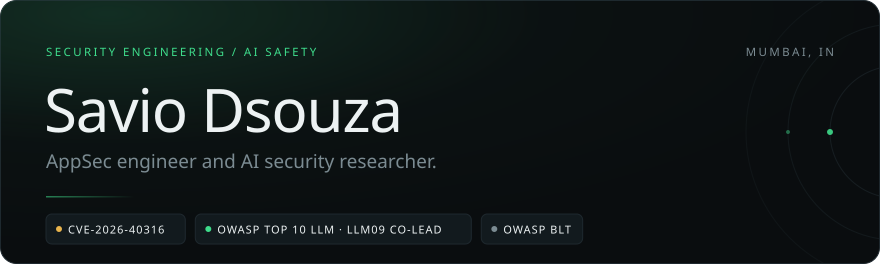
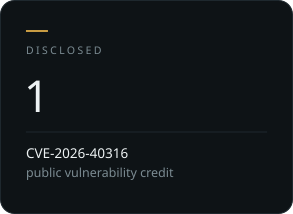

<!-- Cards in ./cards are self-contained SVGs: each carries its own backgrounds,
     its own base64 fonts, its own CSS keyframes, and BOTH palettes. The card
     rotates dark -> light -> dark on a 60s loop (30s each), so both themes are
     visible without the reader changing anything.
     Colour lives on leaf elements as a role class; motion lives on the <g> that
     wraps them. One `animation` shorthand per element, so they never collide.
     If a client refuses to animate, the static attributes render the dark card.
     Numbers are a snapshot from 11 Nov 2026.
     Re-render with: python scripts/build_cards.py
     Refresh the graph first with: python scripts/fetch_contributions.py
     Keep this block free of blank lines, and keep the cards in each row on one
     line with no spaces between them, or the 33.333% thirds will wrap. -->

 
 
 
 
 
 

<a href="https://github.com/S3DFX-CYBER/FindMyGSoC">FindMyGSoC</a> &nbsp;·&nbsp; <a href="https://github.com/TENET-DEV-AI/TENET-AI">TENET-AI</a> &nbsp;·&nbsp; <a href="https://github.com/S3DFX-CYBER/Claude-Skills-Security">Claude-Skills-Security</a> &nbsp;·&nbsp; <a href="https://github.com/S3DFX-CYBER/cve-lite-cli">cve-lite-cli</a>

<a href="https://github.com/S3DFX-CYBER">github</a> &nbsp;/&nbsp; <a href="mailto:saviodsouza8a@gmail.com">email</a>

